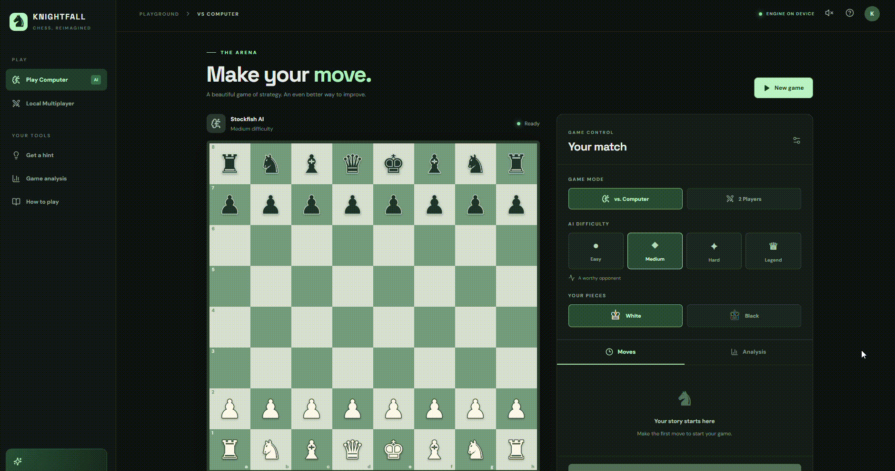

# ♞ Knightfall

### Play. Learn. Conquer.

**Knightfall** is a free, open-source chess application built with React, TypeScript, Electron, and Stockfish. Designed for both web browsers and Windows desktops, Knightfall brings together intelligent computer opponents, local multiplayer, interactive gameplay, and detailed chess analysis in a modern interface.

Whether you're learning chess, challenging yourself against increasingly difficult AI opponents, or reviewing your mistakes after a match, Knightfall provides an accessible chess experience without subscriptions, advertisements, accounts, or paid APIs.

Developed by **Mujtaba Ali Misri**.

---

## 🎬 Application Preview



*Knightfall gameplay demonstration showcasing the chessboard, animated moves, AI opponent, and interactive interface.*

---

## ✨ Features

### ♟️ Play Against the Computer

Challenge a Stockfish-powered chess opponent with four difficulty settings.

| Difficulty | Description |
|---|---|
| Easy | Designed for beginners learning the fundamentals |
| Medium | Balanced gameplay for casual players |
| Hard | Stronger tactical play for experienced players |
| Legend | The most challenging computer difficulty |

The computer uses the Stockfish chess engine, with configurable search depth and skill settings.

Difficulty levels do not represent literal IQ scores or guaranteed Elo ratings.

### 👥 Local Two-Player Mode

Play chess with a friend directly on the same computer.

- Two-player turn-based gameplay
- Automatic turn management
- Legal move validation
- Move history tracking
- Board rotation
- Check and checkmate detection

Local multiplayer works without an internet connection.

### 🧠 Chess Analysis and Game Review

Knightfall includes a Stockfish-powered analysis system that evaluates your moves and helps you understand your decisions.

**Move classifications:**

- **Best:** The strongest available move or a move extremely close to it.
- **Excellent:** A highly effective move.
- **Good:** A solid move that maintains a reasonable position.
- **Inaccuracy:** A move that slightly weakens your position.
- **Mistake:** A move that creates a significant disadvantage.
- **Blunder:** A serious error that can dramatically affect the game.

Additional analysis functionality includes:

- Move-by-move game evaluation
- Estimated player accuracy
- Post-game analysis reports
- Position evaluation
- Interactive game replay
- Review of previous moves

Move classifications are estimates calculated using Stockfish evaluations. They are not official Chess.com or Lichess classifications.

### 🎨 Interactive Chessboard

Knightfall features a modern dark-themed interface designed for clarity and usability.

- Smooth chess-piece movement animations
- Interactive square selection
- Legal move indicators
- Previous move highlighting
- Responsive chessboard
- Chess-piece artwork
- Board flipping
- Optional sound effects
- Accessible reduced-motion support

### ⚙️ Additional Gameplay Features

- Undo moves
- Request move hints
- Restart games
- Resign matches
- Export games in PGN format
- Automatic pawn promotion handling
- Checkmate and stalemate detection
- Castling and en passant support
- Threefold repetition and draw detection
- Persistent game preferences

---

## 🖥️ Windows Desktop Application

Knightfall is available as a standalone Windows desktop application powered by Electron.

The desktop edition provides the same gameplay experience as the website while allowing players to launch Knightfall directly from their computer.

**Desktop features:**

- Dedicated application window
- Windows installer
- Offline gameplay
- Locally bundled chess engine
- No browser tab required
- No account or subscription required

The application can run without an active internet connection once installed.

### Install Knightfall on Windows

Download or build the Windows installer:

`Knightfall-Setup-1.4.0.exe`

Run the installer and follow the setup instructions.

After installation, launch **Knightfall** from the Windows Start menu or your desktop shortcut, if created.

### Build the Desktop Application

Requirements:

- Windows 10 or Windows 11
- Node.js 20+
- npm

Clone the repository:

```bash
git clone https://github.com/mujtabamisri/knightfall-chess.git
cd knightfall-chess
```

Install dependencies:

```bash
npm install
```

Launch the Electron development application:

```bash
npm run desktop:dev
```

Build the Windows installer:

```bash
npm run desktop:win
```

After a successful build, the installer will be generated inside the `release` directory:

```text
release/
└── Knightfall-Setup-1.4.0.exe
```

To create an unpacked application:

```bash
npm run desktop:pack
```

The unpacked Windows executable is located in:

```text
release/win-unpacked/Knightfall.exe
```

This unpacked build is not a single-file portable executable; its accompanying files must remain together.

---

## 🌐 Web Application

Knightfall can also run directly in a modern web browser.

### Requirements

- Node.js 20+
- npm
- A modern browser supporting WebAssembly and Web Workers

### Local Development

Clone the repository:

```bash
git clone https://github.com/mujtabamisri/knightfall-chess.git
cd knightfall-chess
```

Install dependencies:

```bash
npm install
```

Start the development server:

```bash
npm run dev
```

Open the local address displayed in your terminal, typically:

```text
http://localhost:5173
```

### Production Build

Generate the optimized production files:

```bash
npm run build
```

Preview the production build locally:

```bash
npm run preview
```

The production-ready website will be located in:

```text
dist/
```

The web application can be deployed to compatible static hosting platforms such as Vercel, Netlify, Cloudflare Pages, or GitHub Pages.

For GitHub Pages deployments under a repository subpath, Vite's base path and engine asset URLs must be configured appropriately.

---

## 🛠️ Technology Stack

| Technology | Purpose |
|---|---|
| React | Interactive application interface |
| TypeScript | Type-safe application development |
| Vite | Frontend development and production builds |
| Electron | Windows desktop application |
| chess.js | Chess rules, move validation, and game state |
| Stockfish 19 Lite | Computer opponent and chess analysis |
| WebAssembly | Local chess engine execution |
| Web Workers | Background chess engine calculations |
| Lucide Icons | Interface icons |
| CSS | Responsive layouts, transitions, and animations |

---

## 🧩 Chess Engine

Knightfall integrates **Stockfish 19 Lite**, a powerful open-source chess engine.

The engine runs locally using JavaScript, WebAssembly, and Web Workers.

Stockfish powers:

- Computer-controlled opponents
- Difficulty configurations
- Position evaluation
- Move recommendations
- Post-game analysis

No cloud-based AI service or paid API is required.

During installation, the project's setup script copies the required Stockfish engine files into:

```text
public/engine/
```

Both the JavaScript worker and its associated WebAssembly assets are required for proper engine operation.

If Stockfish is unavailable during gameplay, Knightfall includes a basic fallback opponent. Full engine-powered analysis still requires Stockfish.

---

## 📊 Move Classification Methodology

Knightfall uses an approximate analysis system based on Stockfish evaluations.

Each position is analyzed at depth 10, with move quality determined primarily by the estimated evaluation loss.

| Classification | Approximate Centipawn Loss |
|---|---|
| Best | Engine top move or ≤ 10 |
| Excellent | ≤ 35 |
| Good | ≤ 85 |
| Inaccuracy | ≤ 170 |
| Mistake | ≤ 350 |
| Blunder | > 350 |

Player accuracy is estimated using an exponential scoring heuristic.

These classifications are intended for educational feedback and may differ from evaluations produced by other chess platforms.

Analysis time depends on the number of moves and available computer processing power.

---

## 🔒 Privacy and Offline Support

Knightfall is designed as a local-first application.

- No mandatory account registration
- No user tracking built into the application
- No paid subscriptions
- No external AI API dependency
- No backend server required for gameplay
- No cloud database required
- Local chess engine execution

The installed Windows application can function offline with its bundled assets.

---

## 🚀 Project Goals

Knightfall was developed to explore the integration of modern frontend development, desktop applications, game logic, and artificial intelligence.

The project demonstrates practical experience with:

- React component architecture
- TypeScript application development
- State management
- Chess algorithms and legal move validation
- WebAssembly integration
- Web Worker communication
- Asynchronous engine processing
- Responsive UI development
- Interactive animations
- Desktop application packaging
- Cross-platform application architecture

Knightfall aims to combine a visually engaging chess experience with useful analysis tools in a completely free application.

---

## 📌 Future Improvements

Potential future enhancements include:

- Online multiplayer
- Player profiles and match statistics
- Chess puzzles and daily challenges
- Opening explorer
- Advanced evaluation graphs
- Customizable chessboard themes
- Additional chess-piece designs
- Game autosaving and recovery
- Tournament mode
- Player ranking and achievement systems
- Improved analysis explanations
- More desktop customization options

These are planned ideas and are not guaranteed features of the current release.